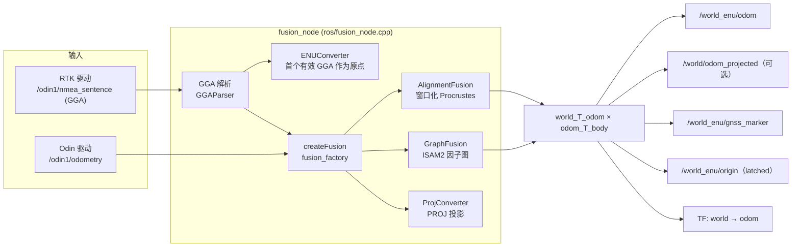

# Odin RTK Fusion

Odin RTK Fusion 是一个 ROS 节点（同时支持 ROS1 与 ROS2），把 Odin SLAM 里程计与 RTK/GNSS 的 GGA 数据融合，输出带全局参考的位姿（ENU，可选投影坐标系）。

本仓库同时也是 [Odin Navigation Stack 2（ONS2）](https://github.com/ManifoldTechLtd/Odin-Nav-Stack2) 的可选 RTK 输入模块，以 submodule 形式挂载在 ONS2 根目录的 `odin_rtk_fusion/` 下。

> 包内的完整参数表和话题说明见 [`src/odin_rtk_fusion/README.md`](src/odin_rtk_fusion/README.md)。本文档侧重整体架构、使用流程和与 ONS2 的衔接方式。

## 目录

- [功能概览](#功能概览)
- [架构](#架构)
- [仓库结构](#仓库结构)
- [环境与依赖](#环境与依赖)
- [构建](#构建)
- [运行](#运行)
- [参数要点](#参数要点)
- [与 ONS2 导航的衔接](#与-ons2-导航的衔接)
- [已知问题](#已知问题)
- [开发指南](#开发指南)
- [故障排查](#故障排查)
- [许可](#许可)

## 功能概览

| 能力 | 说明 |
|------|------|
| 可切换融合后端 | `graph`（ISAM2 因子图）或 `alignment`（窗口化 2D Procrustes），启动时通过 `algorithm_type` 选择 |
| 航向对齐 | 自动估计里程计坐标系与 GNSS ENU 坐标系之间的偏航角 |
| 时间偏移标定 | 基于速度范数互相关估计 Odin 与 GPS 时钟的偏移 |
| 质量感知噪声 | 按 GGA 定位质量（RTK Fix / Float / SPP）和 HDOP 调整 GPS 噪声 |
| 投影输出 | 可选的投影坐标系输出（如 UTM、CGCS2000 高斯克吕格） |
| TF 发布 | 广播 `world → odom`，便于在 RViz 中把点云等数据放到全局坐标系 |
| ODINBIN 回放 | ROS1 下 `bin_replay_node` 可离线回放 `.bin` 采集文件，走同一套融合流程 |

## 架构

### 数据流



### 处理流程

1. **里程计回调**（`processOdom`）：把 `/odin1/odometry` 转为 `OdomData` 送入融合器。融合器未初始化前不输出。初始化后，`world_T_body = world_T_odom × odom_T_body`，发布 ENU 里程计、投影里程计（若启用）和 `world → odom` TF。
2. **GGA 回调**（`processGga`）：解析 GGA，丢弃无效或非有限值。首个有效 GGA 设为 ENU 原点，并在 `/world_enu/origin` 发布一次。随后把经纬高转为 ENU，发布 GNSS 标记，并送入融合器。
3. **初始化**：两种后端都先缓存 GPS 与里程计样本。当 GPS 与里程计的位移都超过 `init_min_*_displacement` 阈值后，`computeInitYawOffset` 估计偏航偏移和时间偏移，之后进入运行状态。

### 融合后端

| 后端 | 类 | 原理 | 适用场景 |
|------|----|------|----------|
| `graph` | `GraphFusion`（`modules/fusion/gtsam/`） | ISAM2 增量优化。关键帧之间用里程计相对位姿做 BetweenFactor；GPS 通过 GPSFactor 约束，天线位置由杆臂换算到车体原点；RTK 固定解（quality 4）额外加入航向先验；节点数超过 `max_nodes` 时边缘化。 | 里程计有噪声，需要持续 GPS 校正 |
| `alignment` | `AlignmentFusion`（`modules/fusion/alignment/`） | 维护最多 50 对（GPS, 里程计）样本的滑动窗口，用最小二乘求 `world_T_odom`（偏航 + 三维平移）。只使用 RTK 固定解（4）与浮点解（5）。 | 里程计精度高（如 SLAM 结果），GPS 只用于标定全局坐标系 |

两者实现同一个接口 `FusionBase`（`addOdom`、`addGPS`、`isInitialized`、`getWorldToOdom`），节点侧只依赖该接口。

### 坐标系

| 坐标系 | 含义 |
|--------|------|
| `odom` | Odin 里程计的局部坐标系 |
| `world` | 本节点输出的 ENU 全局坐标系。原点为首个有效 GGA 的位置，因此**每次启动的原点可能不同** |
| `world_proj` | 投影坐标系的 frame_id（仅当 `output_project_enable: true`） |

### GGA 质量与可视化颜色

| GGA quality | 含义 | GNSS 标记颜色 |
|-------------|------|---------------|
| 4 | RTK Fix | 绿色 |
| 5 | RTK Float | 蓝色 |
| 1、2 | GPS / DGPS | 黄色 |
| 其他（含 0） | 无效或未知 | 红色。quality 0 不参与融合 |

## 仓库结构

本仓库根目录本身就是一个 ROS 工作空间，包位于 `src/odin_rtk_fusion`：

```
odin_rtk_fusion/                       # 仓库根 = 工作空间根
├── .catkin_workspace                  # ROS1 (catkin) 工作空间标记
├── .devcontainer/                     # 开发容器（ROS2 Humble）
│   ├── Dockerfile_ROS2Humble_amd64
│   ├── docker-compose_ROS2Humble.yml
│   └── Readme.md
└── src/
    └── odin_rtk_fusion/               # ROS 包
        ├── CMakeLists.txt / package.xml
        ├── config/fusion_params.yaml  # 算法与坐标系参数
        ├── modules/
        │   ├── common/                # 数据类型、ENU/投影、GGA 解析、日志、参数加载
        │   └── fusion/
        │       ├── fusion_base.hpp    # 融合接口
        │       ├── fusion_factory.cpp # 按 algorithm_type 创建后端
        │       ├── odom_buffer / gps_buffer
        │       ├── yaw_init           # 偏航与时间偏移初始化
        │       ├── gtsam/             # GraphFusion
        │       └── alignment/         # AlignmentFusion
        ├── ros/
        │   ├── fusion_node.cpp        # 在线融合节点（ROS1/ROS2 双支持）
        │   ├── bin_replay_node.cpp    # ODINBIN 离线回放（仅 ROS1）
        │   ├── launch/                # fusion.launch / fusion.launch.py / bin_replay.launch
        │   └── rviz/                  # RViz 配置
        ├── scripts/                   # RTK 驱动示例与启动脚本
        ├── tools/ODINBIN_FORMAT.md    # 回放文件格式
        ├── docs/                      # 硬件参考图
        ├── CHANGELOG.md
        └── README.md                  # 包级详细文档（参数表、话题表）
```

## 环境与依赖

- **ROS**：ROS1 Noetic，或 ROS2 Humble / Iron / Jazzy
- **第三方库**：
  - GTSAM（推荐源码安装，开发容器使用 4.1.1）
  - PROJ（`libproj-dev`）
  - yaml-cpp、spdlog、Eigen3
- **ROS 包**：`nmea_msgs`、`tf2_ros`、`visualization_msgs`、`pcl_ros`、`pcl_conversions`

Ubuntu 下的基础依赖：

```bash
sudo apt install libproj-dev libyaml-cpp-dev libspdlog-dev libeigen3-dev libgtsam-dev
sudo apt install ros-${ROS_DISTRO}-nmea-msgs ros-${ROS_DISTRO}-tf2-ros \
    ros-${ROS_DISTRO}-visualization-msgs ros-${ROS_DISTRO}-pcl-ros ros-${ROS_DISTRO}-pcl-conversions
```

> `libgtsam-dev` 的版本不一定符合要求。如不确定，请按 [GTSAM 官方文档](https://gtsam.org/get_started/) 源码编译，开发容器中使用的是 4.1.1。

### 使用开发容器（推荐 ROS2 Humble）

在仓库根目录执行：

```bash
docker build --pull --rm -f '.devcontainer/Dockerfile_ROS2Humble_amd64' -t 'rtkfusion:ros2_humble-amd64-1.1.0' '.devcontainer'
docker compose -f '.devcontainer/docker-compose_ROS2Humble.yml' up -d
```

> 不要使用 `--build` 启动，否则 compose 会用独立的 BuildKit 缓存重新构建，可能因软件源版本变化而 404。需要重建镜像时，重复第一步，再执行第二步。

## 构建

`ROS_VERSION` 会从已 source 的 ROS 环境自动识别，只有需要覆盖时才传 `-DROS_VERSION=1|2`。

**ROS2（colcon）**，在仓库根目录执行：

```bash
source /opt/ros/humble/setup.bash       # 或 iron / jazzy
colcon build --packages-select odin_rtk_fusion
source install/setup.bash
```

**ROS1（catkin）**，同样在仓库根目录执行：

```bash
source /opt/ros/noetic/setup.bash
catkin_make
source devel/setup.bash
```

`build/`、`install/`、`devel/`、`log/` 已在 `.gitignore` 中忽略。

## 运行

### 快速验证（离线数据）

演示数据 `odin_gnss_demo` 包含里程计和 RTK 数据，下载地址见[包级 README](src/odin_rtk_fusion/README.md#test-data)。

```bash
# ROS2：终端 1 启动融合节点
ros2 launch odin_rtk_fusion fusion.launch.py
# ROS2：终端 2 回放数据
ros2 bag play odin_gnss_demo --rate 3.0 --start-offset 5.0

# ROS1
roslaunch odin_rtk_fusion fusion.launch play_bag:=true bag_path:=/path/to/odin_gnss_demo.bag
```

### 实时运行

按以下顺序启动，每一步都必须先于下一步：

1. **Odin 驱动**：发布 `/odin1/odometry`。驱动参数需设置 `use_host_ros_time: 2`，使里程计时间戳与主机时间对齐，否则 GPS 与里程计时间基准不一致，融合会失败或精度下降。
2. **RTK 驱动**：发布 GGA 到 `/odin1/nmea_sentence`。参考实现为 `src/odin_rtk_fusion/scripts/rtk_string_publisher_ros2.py`（BG550 模块）。依赖 `pyserial`，默认串口 `/dev/ttyACM0`，波特率 115200。
3. **融合节点**：

   ```bash
   ros2 launch odin_rtk_fusion fusion.launch.py algorithm_type:=alignment
   ```

`src/odin_rtk_fusion/scripts/` 下的 `start_odin.sh`、`start_rtk.sh` 含有占位路径（如 `/home/xxx/...`），使用前需要改成你的实际路径。

### 离线回放（ROS1）

用 `bin_replay_node` 把 ODINBIN 采集文件送入完整融合流程，适合回归测试和调参：

```bash
rosrun odin_rtk_fusion bin_replay_node \
    _bin_file:=/path/to/capture.bin \
    _config_file:=$(rospack find odin_rtk_fusion)/config/fusion_params.yaml \
    _playback_speed:=1.0            # 0 表示不等待，尽快回放
```

输出与在线节点一致，另外会发布原始的 `/odin1/odometry_highfreq` 与 `/h1_odom` 供检查。文件格式见 [`src/odin_rtk_fusion/tools/ODINBIN_FORMAT.md`](src/odin_rtk_fusion/tools/ODINBIN_FORMAT.md)。

### 话题与 TF

| 方向 | 名称 | 类型 | 说明 |
|------|------|------|------|
| 输入 | `/odin1/odometry` | `nav_msgs/Odometry` | Odin 里程计 |
| 输入 | `/odin1/nmea_sentence` | `nmea_msgs/Sentence` | 必须包含 GGA |
| 输出 | `/world_enu/odom` | `nav_msgs/Odometry` | ENU 下的融合位姿（header `world`，child `base_link`，见[已知问题](#已知问题)） |
| 输出 | `/world_enu/gnss_marker` | `visualization_msgs/Marker` | GNSS 位置标记 |
| 输出 | `/world_enu/origin` | `sensor_msgs/NavSatFix` | ENU 原点，latched，仅发布一次 |
| 输出 | `/world/odom_projected` | `nav_msgs/Odometry` | 投影坐标（`output_project_target_crs`，默认 UTM 50N，单位 m），frame 为 `world_proj`。仅 `output_project_enable: true` 时发布 |
| TF | `world → odom` | — | 融合估计的全局校正。`publish_tf: false` 时不发布 |

## 参数要点

完整参数表见[包级 README](src/odin_rtk_fusion/README.md#configuration)。以下是最常需要修改的几项，位于 `src/odin_rtk_fusion/config/fusion_params.yaml`：

| 参数 | 默认 | 说明 |
|------|------|------|
| `algorithm_type` | `graph` | `graph` 或 `alignment` |
| `initial_lever_arm` | `[-0.63, 0.0, 0.87]` | 天线相对车体（Odin 位姿）的位置 [x, y, z]（m）。改动天线安装后必须修改 |
| `odom_position_sigma` / `odom_rotation_sigma` | `0.005` / `0.1` | 里程计噪声 |
| `gps_base_sigma` | `5.0` | GPS 噪声 = `gps_base_sigma × HDOP` |
| `max_gps_match_dt` | `0.5` s | GPS 与里程计的最大时间差 |
| `max_nodes` | `5000` | 因子图节点上限，超过后边缘化（仅 `graph`） |
| `init_min_gps_displacement` / `init_min_odom_displacement` | `2.0` m | 触发初始化所需的最小位移 |
| `input_lla_crs` | `EPSG:4326` | 输入的经纬高坐标系 |
| `output_project_enable` / `output_project_target_crs` | `true` / `EPSG:32650` | 投影输出开关与目标坐标系 |
| `publish_tf` | `true` | 是否广播 `world → odom` TF。与 ONS2 同图运行时设为 `false` |

**算法选择的优先级**：ROS 参数 `algorithm_type`（非空时）> YAML 中的 `algorithm_type` > 默认 `graph`。由于 launch 文件默认传入 `graph`，只改 YAML 不会生效，需要通过 launch 参数覆盖，或修改 launch 文件的默认值。

## 与 ONS2 导航的衔接

本节说明 RTK 融合如何与 ONS2 配合使用。下列结论均已对照两个仓库的代码与文档核实；未能从代码确认的部分会明确标注。

### 集成关系

- ONS2 在其 README 中把 `odin_rtk_fusion` 列为“可选 RTK 输入”，安装方式为 `git submodule update --init odin_rtk_fusion`。
- ONS2 自身不包含 RTK 驱动，当前仓库中也没有代码订阅本包的输出话题（`/world_enu/odom` 等）。因此，RTK 融合目前是一个独立的定位模块，与 ONS2 导航之间的数据通路需要你来接通。
- 两者共用同一个 Odin 驱动。ONS2 的 `/odin1/odometry` 可以直接作为本节点的里程计输入。

### 数据接口对照

| 方向 | ONS2 | RTK 融合 | 是否需要处理 |
|------|------|----------|--------------|
| 里程计输入 | `/odin1/odometry` 由 Odin 驱动发布 | 订阅同一话题 | 无需处理 |
| GGA 输入 | ONS2 不包含 | 订阅 `/odin1/nmea_sentence` | 需要运行 RTK 驱动 |
| 全局位姿输出 | 导航在 `map` 中规划，航点为 `map` 坐标 | 输出 `world`（ENU）位姿 | **需要建立 `world ↔ map` 的对齐**（见下） |
| TF | Odin 驱动在 TRANSFORM 模式下发布 `odom → map` | 发布 `world → odom`（可通过 `publish_tf: false` 关闭） | **会冲突**，需关闭 RTK 的 TF（见下） |

### 坐标系对齐

ONS2 的导航参考系是 `map`（由 `map_server` 加载的静态栅格图），而 RTK 融合的输出是 `world`（ENU）。两者之间没有内置变换。

- ONS2 的 `ros2_ws/scripts/test_nav_control_ros2.py` 中导入了 `RtkNavControl`，它接收 WGS84 经纬度目标，并使用 `tf_buffer` 与 `map_frame`。但 `rtk_nav_control` 模块**不在当前 ONS2 仓库中**，其经纬度到 `map` 的换算方式无法从本仓库确认。
- 因此，接入 RTK 全局定位需要你提供或确认 `map` 与 `world` 之间的固定变换（平移 + 偏航）。这通常通过在地图已知位置（如与 ENU 原点的对应关系）上做一次标定得到。

### TF 冲突（必须注意）

同一 TF 树中，一个子坐标系只能有一个父坐标系。两者的冲突如下：

- Odin 驱动（TRANSFORM 模式）发布 `odom → map`，即 `map` 是 `odom` 的父坐标系。
- 本节点发布 `world → odom`，即 `world` 是 `odom` 的父坐标系。

如果两者同时位于同一个 ROS 域并广播到 `/tf`，`odom` 的父坐标系会在 `map` 与 `world` 之间来回切换，导致 TF 查询结果不稳定。

**与 ONS2 同图运行时，设置 `publish_tf: false`** 关闭 `world → odom` 的广播（默认 `true`，保持原有行为）。然后用话题方式接入 RTK 结果：

1. 由你的上层节点读取 `/world_enu/odom`，在 `map` 与 `world` 之间换算，而不是依赖 RTK 节点的 TF。
2. 如需完全隔离，可把 RTK 节点放在独立的 ROS 域（`ROS_DOMAIN_ID`），并通过话题桥接所需数据。

### 输出 frame 的命名

`/world_enu/odom` 的 `child_frame_id` 写为 `base_link`，但从代码看，它实际表示的是 Odin 里程计的车体位姿（`initial_lever_arm` 定义为天线相对该车体的位置）。在 ONS2 中，`odin1_base_link` 才是传感器位姿，`base_link` 是地面投影中心，两者之间通过静态变换连接。因此，把该输出当作 ONS2 的位姿使用时，应理解为 `odin1_base_link`，不要直接当作 ONS2 的 `base_link`。

### 推荐启动顺序

1. 启动 ONS2 依赖的 Odin 驱动（`use_host_ros_time: 2`）。
2. 启动 RTK 驱动，发布 `/odin1/nmea_sentence`。
3. 启动本节点 `fusion.launch.py`（`algorithm_type` 按需选择），并在 `config/fusion_params.yaml` 中设置 `publish_tf: false`。
4. 启动 ONS2 的 bringup 与导航；注意 TF 冲突的处理方式已确定。

### 验证清单

```bash
ros2 topic echo /world_enu/origin --once       # 首个有效 GGA 后应有一次输出
ros2 topic hz /world_enu/odom                  # 初始化完成后应持续输出
ros2 run tf2_ros tf2_echo world odom           # 确认 world → odom 正常
```

节点日志中应依次出现 `FusionNode initialized (algorithm=...)` 和 `ENU origin set: ...`。

## 已知问题

1. **`world` 原点随启动变化。** ENU 原点取首个有效 GGA，跨次启动的 `world` 坐标不具有可比性，不能直接保存或复用上一次的 `world` 坐标。
2. **`/world_enu/odom` 的 `child_frame_id` 为 `base_link`**，与 ONS2 的 `base_link` 语义不同（见上文）。
3. **launch 默认值覆盖 YAML 的 `algorithm_type`**（见[参数要点](#参数要点)）。

## 开发指南

### 新增融合后端

1. 在 `modules/fusion/` 下实现 `FusionBase`，覆盖 `addOdom`、`addGPS`、`isInitialized`、`getWorldToOdom`。
2. 在 `modules/fusion/fusion_factory.cpp` 中添加对应的 `algorithm_type` 分支。
3. 在 `src/odin_rtk_fusion/CMakeLists.txt` 的 `fusion_algo` 源文件列表中加入新文件。
4. 参数如需新增，在 `modules/common/parameter.hpp` 的 `FusionAlgorithmParams` 与 YAML 中同步添加。

节点侧（`ros/fusion_node.cpp`）只依赖 `FusionBase`，不需要修改。

### 代码约定

- ROS1 与 ROS2 通过 `ODIN_ROS2` 宏做条件编译，修改 `fusion_node.cpp` 时两边都要保持一致。
- 日志统一使用 `LOG_INFO`、`LOG_WARN` 等宏（`modules/common/logger.hpp`，基于 spdlog）。

## 故障排查

| 现象 | 可能原因 |
|------|----------|
| 节点启动后没有 `/world_enu/odom` 输出 | 初始化未完成。检查 GPS 与里程计是否都有足够位移（默认各 2 m），以及 GGA 的 quality 是否为 0 |
| GGA 被跳过，日志出现 `Skip GGA` | GGA 为无效定位或坐标超出范围 |
| 融合不收敛或位置跳变 | 检查 Odin 驱动的 `use_host_ros_time`；检查 `initial_lever_arm` 是否与实际安装一致 |
| 启动时选错了算法 | launch 默认值覆盖了 YAML，见[参数要点](#参数要点) |
| `/world/odom_projected` 没有输出 | `output_project_enable` 为 false，或 PROJ 初始化失败（日志中会有 warn） |
| 在 ONS2 中 TF 查询不稳定 | `odom` 同时有 `map` 和 `world` 两个父坐标系，设置 `publish_tf: false`，见[TF 冲突](#tf-冲突必须注意) |

## 许可

本项目采用 [Apache License 2.0](src/odin_rtk_fusion/LICENSE) 许可。版权所有 © 2026 Manifold Tech Ltd.
