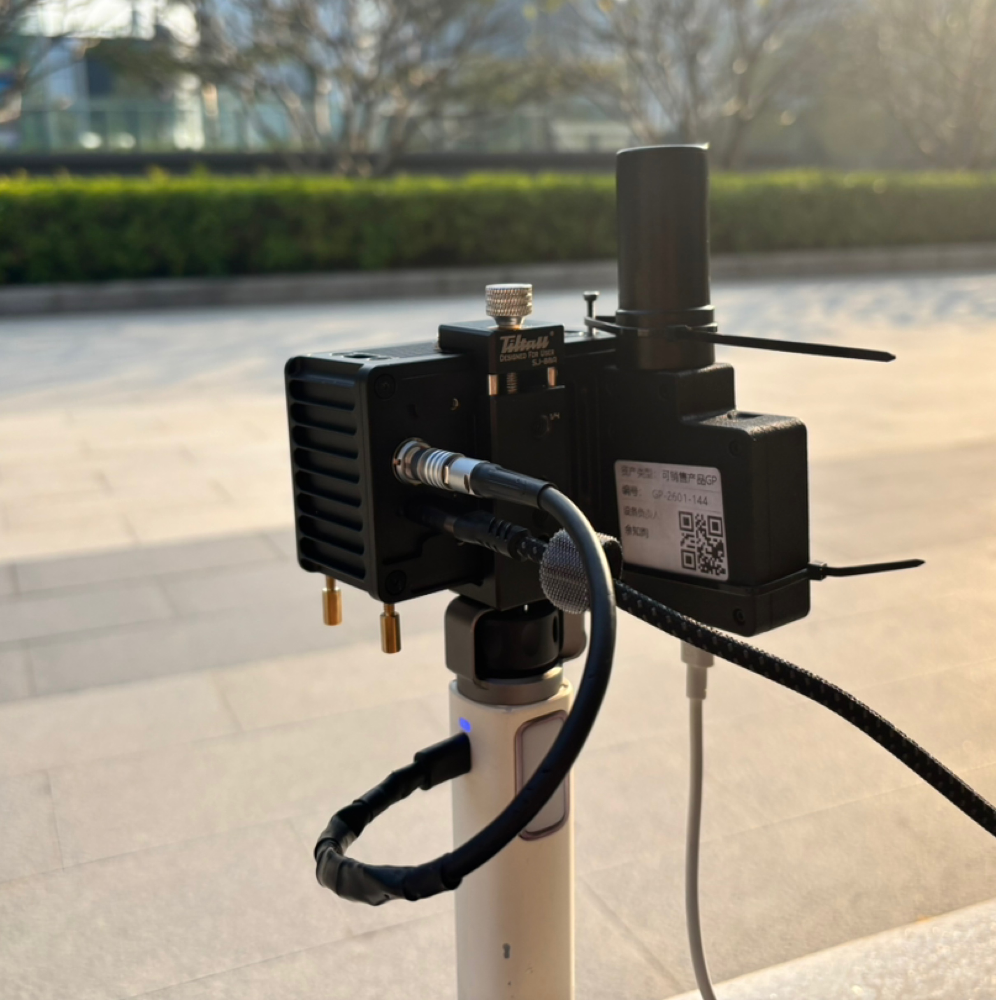

# Odin RTK Fusion

A ROS node that fuses SLAM odometry with GNSS (GGA) data to produce globally referenced poses in ENU coordinates. Two interchangeable fusion backends are provided: an **ISAM2 factor graph** (`GraphFusion`) and a **windowed 2D Procrustes alignment** (`AlignmentFusion`) — switch at launch time.

## Features

- **Switchable fusion backends** — runtime-selectable via `algorithm_type`:
  - `graph` (`GraphFusion`): ISAM2 incremental factor graph with odom / GPS / heading factors, automatic marginalization, and lever-arm compensation.
  - `alignment` (`AlignmentFusion`): windowed 2D Procrustes closed-form alignment of `world_T_odom` (yaw + xyz offset).
- **Yaw alignment estimation** — automatically computes the heading offset between the odometry frame and the GNSS ENU frame
- **Time offset calibration** — estimates the temporal offset between odometry and GPS clocks via speed-norm correlation
- **Quality-aware GPS noise modeling** — adjusts GPS factor noise based on fix type (RTK Fix / Float / SPP) and HDOP (GraphFusion only; AlignmentFusion filters on Fix/Float quality)
- **Coordinate projection output** — optionally outputs poses in projected coordinate systems (UTM, Gauss-Kruger, etc.)
- **TF tree publishing** — broadcasts `world → odom` transform so that point clouds and other sensor data can be visualized in global coordinates via RViz
- **ODINBIN replay tool** (ROS1) — `bin_replay_node` replays offline `.bin` captures through the same fusion pipeline (see `tools/ODINBIN_FORMAT.md`)
- **Compatibility** — supports both ROS1 and ROS2

## Prerequisites

### Dependencies

```bash
# Third-party libraries
sudo apt install libproj-dev libyaml-cpp-dev libspdlog-dev libeigen3-dev

# GTSAM (recommended to install from source, see https://gtsam.org/get_started/)
sudo apt install libgtsam-dev  # or build from source

# ROS dependencies (ROS_DISTRO=noetic for ROS1, or humble/iron/jazzy for ROS2)
sudo apt install ros-${ROS_DISTRO}-nmea-msgs ros-${ROS_DISTRO}-tf2-ros \
    ros-${ROS_DISTRO}-visualization-msgs
```

### Build

`ROS_VERSION` is auto-detected from the ROS setup you sourced (`$ROS_VERSION` env var). The `-DROS_VERSION=...` flag below is only needed to override that auto-detection.

**ROS1 (catkin):**

```bash
cd ~/catkin_ws
source /opt/ros/noetic/setup.bash
catkin_make                        # or: catkin_make -DROS_VERSION=1
source devel/setup.bash
```

**ROS2 (colcon):**

```bash
cd ~/ros2_ws
source /opt/ros/humble/setup.bash  # or iron/jazzy
colcon build --packages-select odin_rtk_fusion
source install/setup.bash
```

## Quick Start

### Test Data

A demo rosbag is available for verification:

| File | Description | Download |
|------|-------------|----------|
| `odin_gnss_demo.bag` | Contains odometry + RTK data | [Feishu](https://vvcazjv268.feishu.cn/file/OqSPbvXKyoJ0wOxh2hMc7GXSnqc) |

### ROS1

```bash
roslaunch odin_rtk_fusion fusion.launch play_bag:=true bag_path:=/path/to/odin_gnss_demo.bag
```

### ROS2

```bash
# Terminal 1: launch fusion node
ros2 launch odin_rtk_fusion fusion.launch.py

# Terminal 2: play test data
ros2 bag play odin_gnss_demo --rate 3.0 --start-offset 5.0
```

### Launch Parameters

**ROS1** (`fusion.launch`):

| Parameter | Default | Description |
|-----------|---------|-------------|
| `config_file` | `config/fusion_params.yaml` | Path to the algorithm configuration file |
| `algorithm_type` | `graph` | Fusion backend: `graph` or `alignment` |
| `output_project_topic` | `/world/odom_projected` | Topic name for projected odometry output |
| `output_project_frame_id` | `world_proj` | Frame ID for projected odometry |
| `play_bag` | `false` | Whether to play a rosbag |
| `bag_path` | `$HOME/odin_gnss_demo.bag` | Path to the bag file |
| `bag_rate` | `3.0` | Playback speed multiplier |
| `bag_start` | `5.0` | Playback start offset (s) |
| `bag_loop` | `false` | Loop playback |
| `bag_use_clock` | `true` | Publish `/clock` from bag (enables sim time) |

**ROS2** (`fusion.launch.py`):

| Parameter | Default | Description |
|-----------|---------|-------------|
| `config_file` | `config/fusion_params.yaml` | Path to the algorithm configuration file |
| `algorithm_type` | `graph` | Fusion backend: `graph` or `alignment` |
| `output_project_topic` | `/world/odom_projected` | Topic name for projected odometry output |
| `output_project_frame_id` | `world_proj` | Frame ID for projected odometry |

> For ROS2, play the rosbag in a separate terminal using `ros2 bag play`.

### Topics

**Input:**

| Topic | Type | Description |
|-------|------|-------------|
| `/odin1/odometry` | `nav_msgs/Odometry` | Odometry input (from SLAM) |
| `/odin1/nmea_sentence` | `nmea_msgs/Sentence` | NMEA sentence (must contain GGA) |

**Output:**

| Topic | Type | Description |
|-------|------|-------------|
| `/world_enu/odom` | `nav_msgs/Odometry` | Fused pose in ENU frame (`world` → `base_link`) |
| `/world_enu/gnss_marker` | `visualization_msgs/Marker` | GNSS position marker for RViz |
| `/world/odom_projected` | `nav_msgs/Odometry` | Pose in projected CRS (optional, requires `output_project_enable: true`) |

**TF:**

| Transform | Description |
|-----------|-------------|
| `world` → `odom` | The world-to-odom correction estimated by the fusion algorithm |

> With the `world → odom` transform published, the full TF tree becomes `world → odom → base_link`. You can visualize the transformed SLAM point cloud (e.g. `/odin1/cloud_slam`) in the `world` frame in RViz.

### Configuration

All algorithm parameters are in `config/fusion_params.yaml`.

## Fusion Algorithms

This package ships with **two interchangeable fusion backends**. Both implement the same `FusionBase` interface, but take different approaches:

| Algorithm | Class | When to use |
|-----------|-------|-------------|
| **`graph`** | `GraphFusion` (`modules/fusion/gtsam/`) | ISAM2 factor graph with odom / GPS / heading factors. Best when odom has noise and needs continuous GPS correction. |
| **`alignment`** | `AlignmentFusion` (`modules/fusion/alignment/`) | Windowed 2D Procrustes closed-form least-squares estimate of `world_T_odom` (yaw + xyz offset). Best when odom is accurate (e.g. SLAM result) and GPS only calibrates the global frame. |

### How to switch

**Resolution order** (highest priority wins):

1. ROS parameter `algorithm_type` (non-empty) — provided by the launch file default `graph` or a CLI override
2. YAML `algorithm_type` — used only when the ROS parameter is empty (e.g. running `fusion_node` directly without setting the param)
3. Hard-coded default `graph`

> Because the shipped launch files set `algorithm_type:=graph` by default, editing only YAML will NOT change the algorithm at launch. Either pass the launch argument below, or edit the launch file's default value.

**Temporary override via launch argument:**

```bash
# ROS1
roslaunch odin_rtk_fusion fusion.launch algorithm_type:=alignment

# ROS2
ros2 launch odin_rtk_fusion fusion.launch.py algorithm_type:=alignment
```

**Direct `rosrun` / `ros2 run` (respects YAML when param is omitted):**

```bash
# ROS1
rosrun odin_rtk_fusion fusion_node _config_file:=$(rospack find odin_rtk_fusion)/config/fusion_params.yaml

# ROS2
ros2 run odin_rtk_fusion fusion_node --ros-args -p config_file:=<path/to/fusion_params.yaml>
```

Unknown values fall back to `graph` with a warning log. On startup, the node logs which algorithm was instantiated:

```
[FusionFactory] Creating GraphFusion
FusionNode initialized (algorithm=graph)
```

**Noise Parameters:**

| Parameter | Default | Description |
|-----------|---------|-------------|
| `odom_position_sigma` | `0.005` | Odometry position noise std dev (m) |
| `odom_rotation_sigma` | `0.1` | Odometry rotation noise std dev (rad) |
| `gps_base_sigma` | `5.0` | GPS base noise std dev (m). Actual noise = `gps_base_sigma * HDOP` |

**Fusion Parameters:**

| Parameter | Default | Description |
|-----------|---------|-------------|
| `initial_lever_arm` | `[-0.1, 0, 0.1]` | GPS antenna position in body frame [x, y, z] (m) |
| `max_gps_match_dt` | `0.5` | Max allowed GPS–odom timestamp difference (s) |
| `max_nodes` | `5000` | Max factor graph nodes before marginalization |

**Initialization Parameters:**

| Parameter | Default | Description |
|-----------|---------|-------------|
| `init_gps_buffer_size` | `30` | GPS buffer size during init phase |
| `init_min_gps_displacement` | `2.0` | Min GPS displacement to trigger init (m) |
| `init_min_odom_displacement` | `2.0` | Min odom displacement to trigger init (m) |
| `init_yaw_prior_sigma` | `0.2` | Initial yaw prior noise (rad) |

**Coordinate Reference System (CRS) Parameters:**

| Parameter | Default | Description |
|-----------|---------|-------------|
| `input_lla_crs` | `EPSG:4326` | Input LLA coordinate system (WGS84) |
| `output_project_enable` | `true` | Enable projected coordinate output |
| `output_project_target_crs` | `EPSG:32650` | Target projection CRS |

Common projection CRS options:
- `EPSG:32650` — WGS84 / UTM zone 50N (E114°–120°)
- `EPSG:4526` — CGCS2000 / 3-degree Gauss-Kruger zone 38 (Shenzhen)
- `EPSG:4527` — CGCS2000 / 3-degree Gauss-Kruger zone 39 (Beijing)

**Output Parameters:**

| Parameter | Default | Description |
|-----------|---------|-------------|
| `publish_tf` | `true` | Broadcast the `world → odom` TF. Set `false` when another stack owns the `odom` TF parent (e.g. ONS2 `map → odom`) |

## File Structure

```
odin_rtk_fusion/
├── config/
│   └── fusion_params.yaml          # Algorithm and CRS configuration
├── modules/
│   ├── common/                     # Shared utilities
│   │   ├── data_types.hpp          # Common data structures (GPSData, OdomData)
│   │   ├── enu_converter.hpp       # LLA ↔ ENU coordinate conversion
│   │   ├── gga_parser.hpp          # NMEA GGA sentence parser
│   │   ├── logger.hpp / .cpp       # spdlog-based logging
│   │   ├── parameter.hpp           # YAML parameter loader
│   │   └── proj_converter.hpp      # CRS projection via PROJ library
│   └── fusion/                     # Fusion algorithm core
│       ├── fusion_base.hpp         # Abstract interface
│       ├── fusion_factory.hpp / .cpp    # createFusion("graph"|"alignment", ...)
│       ├── gps_buffer.hpp          # GPS sample buffer
│       ├── odom_buffer.hpp / .cpp  # Odometry sample buffer with interpolation
│       ├── yaw_init.hpp / .cpp     # Yaw & time offset initialization
│       ├── alignment/
│       │   └── alignment_fusion.hpp / .cpp  # Windowed 2D Procrustes alignment
│       └── gtsam/
│           └── graph_fusion.hpp / .cpp      # ISAM2 factor graph fusion
├── ros/
│   ├── fusion_node.cpp             # ROS1/ROS2 dual-support live node
│   ├── bin_replay_node.cpp         # ROS1-only ODINBIN replay node
│   ├── launch/
│   │   ├── fusion.launch           # ROS1 launch file
│   │   └── fusion.launch.py        # ROS2 launch file
│   └── rviz/
│       ├── fusion.rviz             # ROS1 RViz config
│       └── fusion_ros2.rviz        # ROS2 RViz config
├── scripts/
│   ├── rtk_string_publisher_ros2.py  # Example RTK driver (BG550)
│   ├── plot_position.py            # Position log visualization
│   └── plot_speed.py               # Speed log visualization
├── tools/
│   └── ODINBIN_FORMAT.md           # Binary capture format spec (for bin_replay_node)
├── docs/
│   └── odin_bg550.jpg              # Reference hardware photo (Odin + BG550)
├── CMakeLists.txt
├── package.xml
└── README.md
```

## RTK Adapter Guide

<p align="center">
  
  <br/>
  <em>Reference hardware: Odin SLAM device with a Tellussense BJ-BG550 RTK module and GNSS antenna.</em>
</p>

To use a custom RTK receiver with this node, you need to:

1. **Publish GGA sentences** — your RTK driver must publish `nmea_msgs/Sentence` messages containing raw NMEA GGA strings
2. **Topic name** — publish to `/odin1/nmea_sentence`
3. **Launch order** — start the RTK driver before launching the fusion node

A reference driver for the BG550 module is provided at `scripts/rtk_string_publisher_ros2.py` (matches the hardware shown above).

## Offline Replay (ROS1)

For regression testing or parameter tuning without live hardware, use `bin_replay_node` to feed an ODINBIN capture through the full fusion pipeline:

```bash
rosrun odin_rtk_fusion bin_replay_node \
    _bin_file:=/path/to/capture.bin \
    _config_file:=$(rospack find odin_rtk_fusion)/config/fusion_params.yaml \
    _playback_speed:=1.0            # 0 = no wait (fastest)
```

Outputs match the live `fusion_node` (`/world_enu/odom`, `/world_enu/gnss_marker`, `world → odom` TF, plus raw `/odin1/odometry_highfreq` and `/h1_odom` for inspection).

See [`tools/ODINBIN_FORMAT.md`](tools/ODINBIN_FORMAT.md) for the binary format specification.

## Odin ROS Driver

This fusion node is designed to work with the [Odin ROS Driver](https://github.com/manifoldsdk/odin_ros_driver).

**Time synchronization** is critical for accurate fusion. The odometry timestamps from the Odin device must be aligned with the host clock so that they can be correctly matched with GPS timestamps.

Set the following parameter in the Odin ROS Driver configuration:

| Parameter | Value | Description |
|-----------|-------|-------------|
| `use_host_ros_time` | `2` | align odin1 time to host time via NTP-like synchronization, timestamp is the sensor data reception time on host time axis |

> Without this setting, the odometry and GPS data may have inconsistent time bases, which will cause the fusion to fail or produce inaccurate results.


## License

Apache License 2.0
